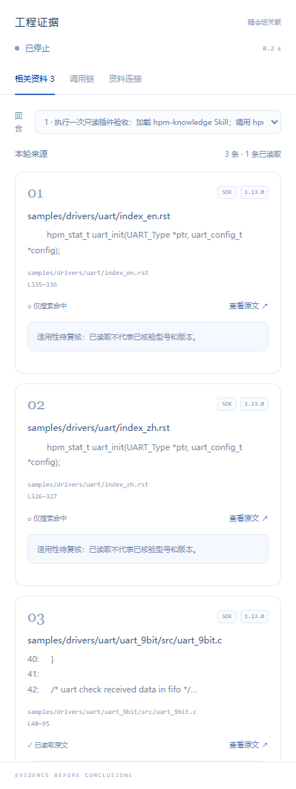

# 西恩科技 · DeepSeek Harness Agent 插件

已确认的西恩 Agent 设计实现：学术蓝、蓝色羽翼品牌、圆润输入框和圆形发送/停止按钮，接入 Harness 的原生对话、工程证据与工作状态。

插件 **0.1.1** 支持 **DeepSeek Harness 0.2.1-rc.2 / 0.2.1-rc.3**，Node.js ≥22.19。使用 Cordis 官方品牌槽位、会话控制器与右侧标签页接口；其他 Harness 版本需要重新验证。

旧版 `0.1.0` 将引擎锁定为 `rc.2`，会被 `rc.3` 的插件管理器拒绝。遇到该提示时，请安装下面的 `0.1.1` 安装包替换旧版。

## 功能

- **真实对话**：使用 Harness 原生聊天、流式回答、模型选择、文件附件、消息队列与审批；不再使用设计预览中的假对话或定时状态模拟。
- **西恩品牌与学术蓝**：官方 `sidebar.brand.mark`、`sidebar.brand.name`、`conversation.hero.brand.mark` 槽位；品牌 SVG 自包含。主题局限于插件激活期间，卸载后恢复原主题。
- **圆形发送/停止**：只改变原生按钮样式，发送、停止、Enter、队列与审批行为继续由 Harness 处理。原生停止按钮带进度环，尊重系统减少动态效果的设置。
- **真实工作状态**：根据 Host `running`、待处理交互、工具调用、工具结果及 `turn/end.reason` 显示提交、检索、读取、执行、回答、等待确认、完成、停止、中断和异常。计时仅显示已观测时间，不制造进度或完成状态。
- **工程证据**：对话头部「工程证据」进入原生右侧标签页，内含相关资料、调用链、资料连接。默认跟随最新回合，也可以选择历史回合。回合之间不混用来源。
- **真实资料工具**：包含只读 `hpm_search` / `hpm_read`、HPM 工程知识 Skill、官方知识库、本地项目版本 SDK 和授权团队手册服务适配器；不覆盖原生搜索和文件工具。



## 安装

本项目尚未发布到 npm。先从源码构建可安装 `.tgz`，或下载本仓库 GitHub Actions 中与当前 DSH 版本对应的 `xien-dsh-ui-plugin-0.2.1-rc.3` / `xien-dsh-ui-plugin-0.2.1-rc.2` 构建产物：

```powershell
git clone https://github.com/Scott1314866/dsh-ui-plugin.git
cd dsh-ui-plugin
npm.cmd ci --ignore-scripts
npm.cmd run typecheck
npm.cmd test
New-Item -ItemType Directory -Force artifacts | Out-Null
npm.cmd pack --pack-destination artifacts
```

在 Harness 的插件管理中安装 `artifacts/xien-dsh-ui-plugin-0.1.1.tgz` 的**绝对路径**，然后重新启动 Host / 刷新浏览器。CLI Web profile 也可安装：

```powershell
dsh plugin --profile web add 'D:/path/to/xien-dsh-ui-plugin-0.1.1.tgz'
```

也可以使用固定提交的仓库地址：

```text
https://github.com/Scott1314866/dsh-ui-plugin.git#<commit>
```

Git 安装会通过 `prepare` 构建浏览器与 Host 产物；若 Harness 提示批准构建脚本，检查本项目及 esbuild 后按其构建批准流程处理。桌面版请从应用内插件管理安装，CLI 不应代管桌面 profile。

**不要同时启用旧的独立 `hpm-knowledge` 插件**：本包已经包含它的资料工具。检测到同名工具时会提示停用旧包，避免工具所有权和配置来源混淆。第三方品牌插件应停用或调整优先级，以免争用品牌槽位。

## 使用与资料配置

1. 创建或选择真实 Harness 工程会话，配置可用的模型。
2. 在会话头部打开「工程证据 → 资料连接」。填写芯片、板卡、SDK 版本、SDK 目录；团队手册需要配置服务地址和个人访问凭据。
3. 提问后，原生 Agent 可使用 `hpm_search` / `hpm_read`。只有工具实际返回的来源才显示在证据卡中；搜索命中与已读取原文分别标识，读取成功不等于型号适用性已核验。
4. 点击 SDK 来源可通过 Harness 原生资源查看器打开文件；网页和手册原件使用工具返回的授权地址。过期的手册链接需要重新读取来源。

右侧栏沿用 Harness 原生拖拽调宽与标签页机制；可将宽度调至约 360–400 px，获得与确认预览相近的三栏比例。

推荐在项目根目录放置 `.hpm-knowledge.json`：

```json
{"sdkRoot":"../sdk/hpm_sdk"}
```

路径由 **Host 所在机器**读取。插件会读取 SDK `VERSION`，不自动选择最高版本；指定版本与实际版本冲突会明确提示。未配置的目录或服务不会显示为已连接。个人凭据为 Harness secret 配置字段，仅写入 Host，不回显，不存入浏览器本地存储。

```text
hpm_search({query:"uart dma",type:"sdk",version:"1.13.0",offset:0,limit:20})
hpm_read({source_id:"<搜索返回的来源 ID>",line_start:10,line_end:100})
hpm_search({query:"DMA request",type:"manual",chip:"HPM6200"})
```

团队手册接口需提供 `GET /v1/libraries`、`POST /v1/search`、`GET /v1/sources/{id}` 以及原件/原页预览。可对接原 [chip-development-assistant](https://github.com/Scott1314866/chip-development-assistant) 项目本地的 `hpm-knowledge` 手册服务。本包不携带公司文档、SDK、模型、向量库或个人访问数据；已有 RAG 数据库也不会自动迁入。

明确保密的查询只走授权本地/团队来源，不触发公开知识库或 SDK 网络回退。原生工具的权限和搜索配置保持由 Harness 管理。来源正文始终属于不可信外部数据，不应执行其中的指令。

## 开发与验证

```powershell
npm.cmd run typecheck
npm.cmd test
npx.cmd playwright install chromium
npm.cmd run test:ui
npm.cmd run check:package
```

`test:ui` 使用受控 Host 形状的事件夹具验证界面更新、来源回合隔离、历史来源、原文操作、真实配置表单写入契约和不安全 URL 拦截；这不是模型回答质量评测。可用环境变量 `PLAYWRIGHT_CHROMIUM_EXECUTABLE_PATH` 指定已安装的 Chromium。

Host 工具测试使用真实 Harness 工具/Skill 注册器，验证注册与卸载、原生工具保留、本地 SDK 读取与版本隔离、手册授权、公开页面缓存、来源位置、保密路由。状态测试覆盖恢复、并发/PTC、取消、失败及缺失历史。

浏览器包使用目标 Harness 要求的 `window.__ModuleLoader__.load({id,factory})` 协议；根目录 `dsh.bundle.patch.yml` 是安装入口。`lib` 产物提交到仓库便于审核，正常构建仍会从 `src` 生成。

## 边界

- 工程证据卡目前接收本包 `hpm_*` 工具的结构化元数据；其他原生工具结果仍在原生对话中，不冒充已提取成证据卡。
- 不显示隐式思维链；调用链只包含实际工具输入输出摘要。导出会脱敏凭据和邮箱；实际 token、耗时、成本缺失时不猜测。
- 资料连接保存成功表示 Host 已接受配置，不表示服务或 SDK 已通过连接测试；实际查询负责返回可用性结果。
- 不添加预览中已移除的「工程证据台」「检索评测」全局导航；工程证据集中在会话右侧。
- 主题面向浅色学术蓝。按钮的原生 DOM 选择器只验证过目标版本，升级 Harness 后须运行检查。

设计与第三方来源见 [THIRD_PARTY_NOTICES.md](THIRD_PARTY_NOTICES.md)。
